# Page types and layouts

Understanding how [!INCLUDE[prod_short](includes/prod_short.md)] displays a page dependent on its *page type* is important to be able to create a good user experience. There are also several page properties and variations of the page structures that can help create an intuitive and efficient user interface.

This article focuses on pages in a desktop browser. The clients share AL page definitions and adapt supported layouts to the device. Some page types and features have client-specific restrictions.

## Understanding page types

Choosing the right page type is the first step when creating or modifying a page. The next step is to organize the page contents to suit its purpose in your solution. We recommend that you design pages based on the user tasks that you want to support.

The following table provides an overview of page layout types, their typical uses, and basic characteristics. To specify a page type, use the `PageType` property. Learn more in [PageType property](properties/devenv-pagetype-property.md).

Report and XMLport request pages use additional page-type values: `ReportPreview`, `ReportProcessingOnly`, and `XmlPort`. These values describe request pages generated for their parent objects, rather than separate layout patterns in this table. `ReportPreview` classifies a report's request page, not the report-preview viewer.

|Page type|Examples of use|Main data display|Characteristics|
|---------|---------------|----------------|---------------|
|`RoleCenter`|Overview of business performance and the start page for a specific user profile.|Defined by the embedded parts.|A collection of parts, such as cues and KPIs, and the contents of the navigation pane.|
|`Card`|Master, reference, and set up data management. [Card page example](devenv-simple-card-page-example.md)|Single entity|Titled entity with FastTabs. Might embed parts.|
|`Document`|Transaction and other document management.|Single entity|Titled entity with FastTabs. Should have the document lines ListPart immediately follow one or more header sections.|
|`ListPlus`|Statistics, details, and related data management.|Single entity|An entity-oriented page designed around one or more `ListPart` pages, with supporting fields above or below the parts.|
|`List`|Entity overviews and navigation, and inline editing of simple entities. [List page example](devenv-simple-list-page-example.md)|Collection of entities/entries|A collection displayed in a main repeater. More complex field and part compositions have layout restrictions.|
|`Worksheet`|Line-based data entry tasks, such as journals, and inquiries.|Collection of entities|A main repeater with supporting fields above or below it. `ListPart` compositions aren't fully supported.|
|`StandardDialog`|Routine dialog that starts or progresses a task.|Single or collection|A cancelable dialog with an instruction to the user. Can have one or more groups of fields and parts.|
|`ConfirmationDialog`|Confirmative or exceptional dialog, such as warnings.|Single or collection|A Yes/No dialog with an instruction to the user. Can have one or more groups of fields and parts.|
|`NavigatePage`|A multi-step dialog or wizard.|Single or collection|Can have one or more groups of fields and parts.|
|`CardPart`|A page that is embedded in another page, such as in a FactBox.|Single entity|An entity-oriented part with fields, groups, cues, or other supported controls.|
|`ListPart`|A page that is embedded in another page, such as in a FactBox.|Collection of entities/entries|Single `Repeater` representing columns in a list or table. Can have fields above or below the repeater.|
|`HeadlinePart`|A page that is embedded in a `RoleCenter` page to display relevant insights from across the business.|Single entity|A role center part whose fields provide rotating headlines.|
|`PromptDialog`|A page that enables creating generative AI experiences with the copilot look and feel|Single or collection.|Learn more in [PromptDialog page type](devenv-page-type-promptdialog.md).|
|`UserControlHost`|The `UserControlHost` is used to render a single user control in the client. The layout is optimized by the client to maximize the available space for the user control.|Single entity|Learn more in [UserControlHost page type](devenv-page-type-usercontrolhost.md).|
|`ConfigurationDialog`|Configuration dialogs for setting up and managing agents.|Single entity|Learn more in [ConfigurationDialog page type](devenv-page-type-configuration-dialog.md).|

### The two principal categories of page types

A fundamental characteristic of a page type is how it relates to its data. The two principal categories are *entity-oriented*, typical for `Card` pages, and *collection-oriented*, typical for `List` pages.

|`Card`, `Document`, and `ListPlus`|`List` and `Worksheet`|
|---------|---------------|
|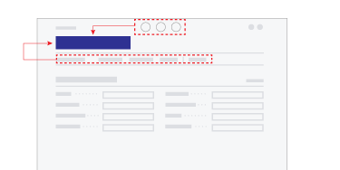|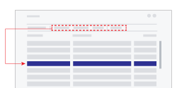|
|Entity-oriented pages have actions that operate in the context identified by the page title.|Collection-oriented pages provide actions in the action bar and row menus. These actions can operate on selected rows, but their AL code must obtain and process the selection.|

#### Entity-oriented pages

In [!INCLUDE[prod_short](includes/prod_short.md)], entity-oriented pages are used to support users when their tasks revolve around a single business entity. The most typical entity-oriented page is the `Card`, which provides details about a single customer or other primary data, and the `Document`, which represents a single transaction, or other important business event, for example, a sales transaction.

`ListPlus` is also an entity-oriented page type. Unlike `Card` and `Document` pages, the `ListPlus` page type is for pages that have a prominent `ListPart` and either few or no header fields.

The `CardPart` page type is an entity-oriented page type for inclusion in another page, for example, in a FactBox.

> [!IMPORTANT]
> Because entity-oriented pages represent a single entity, don't use a `Repeater` group directly in them. Some repeater features might not work properly, and the repeater might not get the expected size. Instead, embed a `ListPart` page that contains the repeater. Learn more in [Work with repeater controls](devenv-repeater-controls.md).
>
> If an existing entity-oriented page uses a repeater, consider changing `Card` to `List`, or `CardPart` to `ListPart`. Review the controls, layout, actions, and record-selection behavior as part of the change. Pay particular attention to actions and variables used by the grid.

#### Collection-oriented pages

Collection-oriented pages support tasks involving multiple entities or records. The most typical collection-oriented page type is `List`, which users can use to find customers, items, and other entities.

The `Worksheet` page type supports data entry, such as journals, and other tasks for managing a collection. Custom fields above or below the collection provide context for the task.

The `ListPart` page type is a collection-oriented page type for inclusion in another page, for example, in a FactBox.

#### Dialog pages

The page types in [!INCLUDE[prod_short](includes/prod_short.md)] that are available exclusively for displaying dialogs, such as the `StandardDialog` and `ConfirmationDialog` page types, can represent an entity *or* a collection. The title caption and actions are suited for both types.

## Composing pages

Within a page, you can combine page fields into groups. Groups help you overview the page by placing related fields together. Within a group, *subgroups* further increase the structure of the data displayed in a page. 

You can also embed a `CardPart` or `ListPart` page. These two page types can't embed other pages.

When you create pages that embed parts, [!INCLUDE[prod_short](includes/prod_short.md)] divides the available screen real estate between the page's groups of fields and any embedded pages. Screen space is divided between field groups and embedded pages, so that you can access the full contents of the page and collapse or expand specific sections of interest. 

Space allocation depends on the page type, the arrangement of field groups and page parts, and the browser window size.

### Content, actions, and FactBox areas

Conventional pages share a structure with areas for content, FactBoxes, and actions. `RoleCenter`, dialogs, part pages, and `UserControlHost` have different structures.

:::image type="content" source="media/page-layout-containers.png" alt-text="Diagram of a page with content and FactBox containers, a page header, and an action bar.":::

The `content` area provides rich layout capabilities, which are described in the coming sections. The `FactBoxes` area is limited to showing a list of parts, usually in a vertical arrangement. The header consists of the title, action bar, and controls for filtering, views, and so on.

Learn more in [Pages overview](devenv-pages-overview.md).

### Field groups and page parts

In the following sections, you find descriptions of typical page layouts, recommendations for how to organize the contents, and illustrations of the principles by which the sections of page share screen real estate. The types of content on a page are illustrated this way:

|Symbol|Section|Notes|
|---------|---------------|----|
|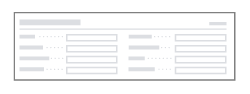|Group of fields, or CardPart|Appears on the page as a FastTab, with fields wrapped in one or more columns.|
|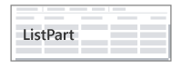|ListPart|List or table layout, with integrated action bar.|
|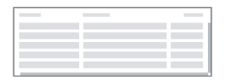|Repeater|List or table layout.|

### Sizing of page sections

The groups of fields and page parts making up a page are rendered when the user opens the page.

Dependent on the size of the available screen real estate, for example, in the browser window on a desktop computer, [!INCLUDE[prod_short](includes/prod_short.md)] sizes the sections automatically to make the most of the space.

A section can use one of three sizing behaviors.

|Symbol|Layout behavior|Notes|
|---------|---------------|----|
||Size to content|Enclosing page uses a scrollbar if needed.|
||Size to content within certain limits|The part uses a scrollbar if content exceeds available space.|
||Size to fill space|The part uses a scrollbar if content exceeds available space.|

The page type determines the section's sizing behavior. The following sections show typical layouts and sizing for each page type.

## Card and document page layouts

Card pages support managing primary and reference data, such as customers, vendors, and items. The name *Card* refers to how you kept this data on paper cards before computerization. Use card pages for setup tasks.

Document pages represent transactions or other important business events. They're the computerized counterpart to paper documents, such as quotes, invoices, and orders. Document pages often have associated workflow or audit trail requirements.

Below are examples of Card and Document page compositions, showing how space is divided. Parts can be combined in more ways than shown here to suit different scenarios.

### Card layouts

|Example 1|Example 2|Example 3|
|---------|---------|---------|
|Sections are placed vertically from top to bottom of the page.|A ListPart can be embedded. In this case, the ListPart's height is limited.|When a ListPart is embedded as the last part on the page, it expands to fill space.|
|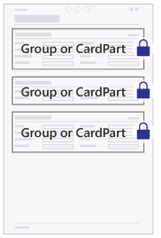|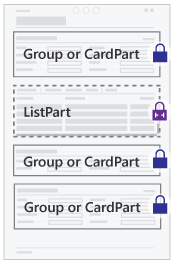|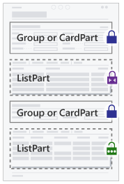|

### Document layouts

|Example 1|Example 2|Example 3|
|---------|---------|---------|
|Sections are placed vertically from top to bottom of the page. The lines ListPart comes after the header sections.|Multiple ListParts can be embedded. In this case, the first ListPart is allowed the most space.|When no ListPart is embedded, the Document layout follows the Card layout exactly.|
|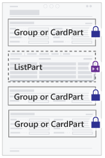|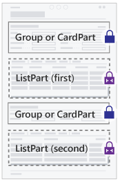|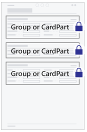|

> [!NOTE]
> The Document page type allows the first ListPart on the page to use extra vertical space before showing a scrollbar. This allows more space for showing the document lines without requiring the user to scroll.

### The well-designed card or document page

From the user's perspective, the following are qualities of a well-designed card or document page:

- Uses the page type `Card` if the page represents primary or reference data, or is a setup page.
- Uses the page type `Document` if the page represents a transaction or other important event in the domain of business.
- Has a page title that clearly identifies the data represented in the page.
- Is optimized for overview by organizing data in FastTabs and marking relevant fields as `Promoted` or `Additional`.
- Favor header fields and other important fields by placing them in a **General** FastTab first.
- Has one or two FactBoxes to give relevant statistics and quick access to related documents.
- For Document pages, a **Lines** FastTab comes second and contains the document lines.
- Don't include a `repeater` control, unless the `repeater` control is in a `ListPart` page that's embedded in the page.

## ListPlus page layouts

ListPlus pages support managing or browsing a collection related to a specific entity or event. For example, the **Customer Sales** page shows sales numbers for a customer and provides viewing options for analysis.

ListPlus pages support analysis and management tasks in the entity context named by the page title. They can show persistent entity data and provide options for viewing or filtering it.

A ListPlus page should not contain a repeater control but typically embeds a `ListPart` page that in turn embeds a repeater. In addition, a ListPlus page can embed groups of fields and CardParts. Below are examples of ListPlus page compositions, showing how space is divided. Parts can be combined in more ways than shown here to suit different scenarios.

|Example 1|Example 2|Example 3|
|---------|---------------|----|
|Page sections are placed from top to bottom. The first ListPart fills vertical space.|When placing two or more ListParts, they share available vertical space.|When placing two ListParts in a group, they share horizontal space.|
|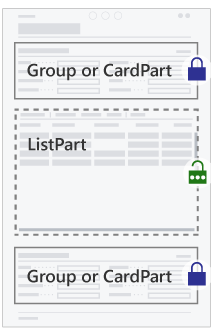|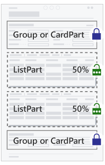|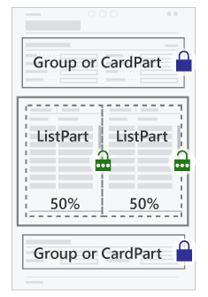|

From the user's perspective, the following are qualities of a well-designed ListPlus page:

- Has a page title that clearly identifies the context for the information presented in the page.
- Is optimized for showing one set of details, and giving the user means to work with them.
- Presents information in the page in such a way that the hierarchy can be understood when read from top to bottom.
- If present, fields that control which data is presented in another FastTab come before that FastTab.
- If present, fields that show data for the selected row in a ListPart come after that ListPart.

## List page layouts

List pages support users viewing and finding specific entities or entries in a collection. Lists that are editable have cells available for data entry and update.

Design a list page around one main `Repeater`. Supported-layout restrictions apply to additional field groups and page parts. The following diagrams show space allocation in different compositions, rather than guaranteeing that every composition is supported. Learn more in [Work with repeater controls](devenv-repeater-controls.md).

|Example 1|Example 2|Example 3|
|---------|---------------|----|
|The repeater control assumes full vertical space.|When a field group or cardpart is embedded, space for repeater is reduced.|When a listpart is embedded, space is shared equally between part and repeater.|
|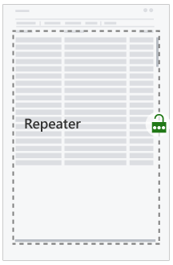|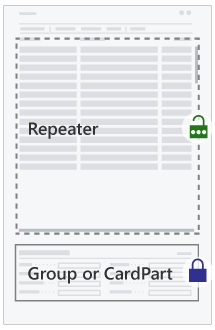|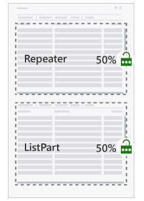|

From the user's perspective, the following are qualities of a well-designed List page:

- Defines a set of columns that's optimized for viewing and filtering the given collection. Optimize the column order for data entry if the list is editable.
- Has a page title that clearly names or identifies the collection of entities/entries presented.
- If a summary or more detail related to the selected row are shown, these appear below the list.
- If custom viewing options are available, these appear above the list.
- Has one or two FactBoxes to give essential collection statistics, and relevant related details for the selected row.

## Worksheet page layouts

A Worksheet page lets users view and manage entries in tabular or matrix form. Use it when custom filters or default field values provide context for the collection. Examples include journals, where the user selects a batch, and inquiry pages, where the user forms a query.

Use a Worksheet page instead of a List page when header fields determine or subdivide the collection. For example, the user might need to select a header value before the repeater shows data. Also use a Worksheet when header fields provide default values for data entry in the repeater.

> [!NOTE]
> The Worksheet page type doesn't support the same part and group compositions as the List page type.

Design a worksheet around one main `Repeater` with supporting fields. More complex page-part compositions, particularly `ListPart` pages, have support restrictions. The following diagrams illustrate space allocation. They aren't a guarantee that every composition is supported.

|Example 1|Example 2|Example 3|
|---------|---------------|----|
|The repeater fills vertical space while leaving room for a group or CardPart above.|Content below the repeater is sized to its contents. The main repeater fills the remaining vertical space.|Groups or parts above and below the repeater leave the remaining vertical space for it.|
|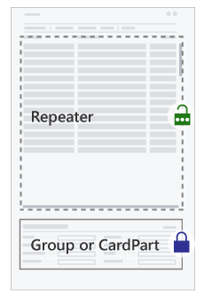|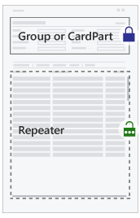|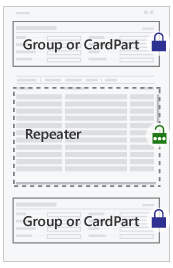|

From the user's perspective, the following are qualities of a well-designed worksheet page:

- Defines a set of columns that's optimized for overviewing and managing the given collection. Columns are ordered relative to their importance.
- Has fields above the grid that specify filtering options or specify the default values effective during data entry and editing in the grid.
- If summary fields or more details of the selected row are shown, these appear below the repeater.

## Dialog page layouts

Some page types in [!INCLUDE[prod_short](includes/prod_short.md)] are available exclusively for displaying dialogs, such as the `StandardDialog` and `ConfirmationDialog` page types. You can also use the `Dialog` data type or a report request page to display a dialog.

Common page types, such as `Card`, `Document`, and `List`, can also be displayed as dialogs. They retain their page composition and embedded elements. AL code activates dialog mode, which adds dismiss buttons in the page footer.

:::image type="content" source="media/page-layout-dialog.png" alt-text="Diagram of a page shown as a dialog with content, FactBoxes, and dismiss buttons in the footer.":::

Generally, [!INCLUDE[prod_short](includes/prod_short.md)] displays dialogs on the screen in a frame that is more narrow and not taking up full vertical height, compared to how pages appear ordinarily. Aside from that, pages lay out their contents according to the same principles, whether displayed as a dialog or not.

Given the size of the screen where the dialog appears, more or less of the page contents are visible without scrolling. When a page contains much content, it's possible for the user to increase the dialog size with the maximize button.

> [!NOTE]
> On desktop, `StandardDialog` and `ConfirmationDialog` pages can provide a maximize button. The button isn't shown in Designer.
>
> In version 24 and earlier, the [Importance property](properties/devenv-importance-property.md) is ignored on `StandardDialog` and `ConfirmationDialog` page types. Version 24 uses runtime 14. This behavior means that a field can't be hidden under the **Show more** action even through personalization or Designer. Starting in version 25, which uses runtime 15, the property is respected in the client and behaves as it does on other page types. After upgrading to version 25, users might have a different experience on these page types.

## Related information

[Page, page fields, and page extension properties](properties/devenv-page-property-overview.md)  
[PageType property](properties/devenv-pagetype-property.md)  
[Actions overview](devenv-actions-overview.md)  
[Use Designer](devenv-inclient-designer.md)  
[Adding a FactBox to a page](devenv-adding-a-factbox-to-page.md)  
[Designing role centers](devenv-designing-role-centers.md)  
